<p align="center">
  
</p>

<p align="center">
  <a href="https://github.com/cablemp5/repak-xtra/releases"></a>
  <a href="https://github.com/cablemp5/repak-xtra/releases"></a>
  
  <a href="LICENSE"></a>
  <a href="https://github.com/X-zant/Repak-X"></a>
</p>

**A Marvel Rivals mod manager built on [Repak X](https://github.com/X-zant/Repak-X), with loadouts, generated previews, Smart loadouts that sort your mods for you, and a first-launch setup that gets mods working in a few clicks.**


## Built on Repak X

repakxtra is a fork of **[Repak X](https://github.com/X-zant/Repak-X)** by **Xzant** (backend, founder) and **Saturn** (frontend), with thanks to **Trumank**, **Krisan Thyme**, **Natimerry**, **amMatt** and the **Marvel Rivals Modding Server**. It adds loadouts, Smart loadouts, previews and the guided first-launch setup on top. Installing, conflict checks, the Asset Explorer, the VFX Updater and the rest of the core are Repak X's work. Please support the original project.

> [!NOTE]
> repakxtra is an unofficial fork: not made by the Repak X team, and not affiliated with NetEase or Marvel.

## How to install repakxtra and your first mod

You need a Windows PC with Marvel Rivals and a mod you downloaded. The mod is a `.pak`, `.zip`, `.rar` or `.7z` file;
you do not need to unzip it.

1. **Download repakxtra.** Open the [newest release](https://github.com/cablemp5/repak-xtra/releases/latest) and click
   the file whose name ends in `-windows.zip`.
2. **Unzip it.** Right-click the zip in your Downloads folder, click **Extract All...**, then **Extract**. You can move
   the folder anywhere, like your Desktop.
3. **Close Marvel Rivals** if it is open.
4. **Open repakxtra.** Double-click `repakxtra.exe` in the folder. If Windows says "Windows protected your PC", click
   **More info**, then **Run anyway**.
5. **Click Set up repakxtra.** The welcome screen opens by itself the first time and shows what loadouts are. Setup
   takes about two minutes, and the rail at the bottom shows its five steps.
6. **Answer "Got mods already?"** Click **Not yet** for a fresh start. (Mods in the game folder already? See
   [the next section](#how-to-set-up-repakxtra-when-you-already-have-mods).)
7. **Get mods working.** Click **Set up all three**. It finds the game, installs the signature bypass (without it the
   game does not load mods) and installs Project Galacta (most skin mods need it), each with its progress, and the game
   folder on the right lights up each file as it goes in. When it says **Mods are ready to go**, click **Next**.
8. **Add your first mod.** Drag the mod file from your Downloads folder onto the window, or click **Choose files...**
   and pick it. The setup steps aside for the install panel: click **Install and save loadout** (leave **Advanced** as
   it is, it is for special mods). The mod installs, is saved as a loadout, and the setup comes back. Click **Next**.
9. **Make it yours (all optional).** **Set up previews** downloads the free preview kit (about 110 MB) and installs
   Blender, so every mod and loadout gets a picture of how it looks in game. If Windows asks whether to allow changes,
   click **Yes**. You can also show repakxtra in your Discord status, make a desktop shortcut, and pick a sound pack
   (try each one first). Click **Next**.
10. **Pick your first loadout.** Click **Continue with** your mod's loadout. Its page opens with the mod on.
11. **Play.** Click **Launch** at the top. The mod loads when the game starts.

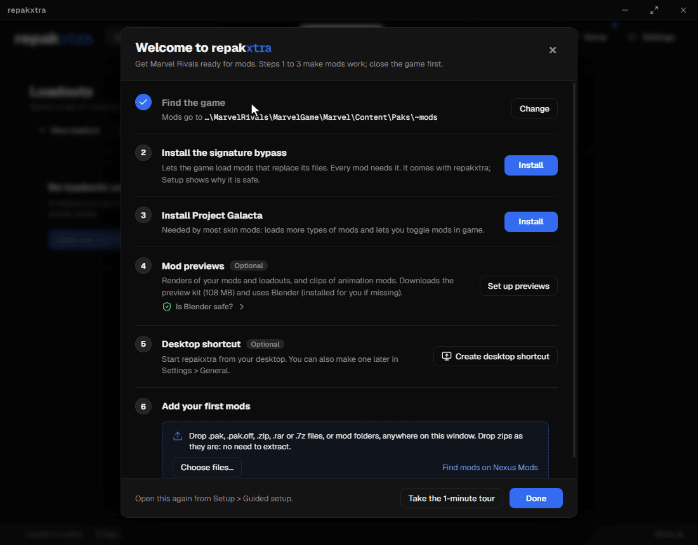

Close the setup any time with the **X**: **Setup > Guided setup** opens it again. To turn a mod off, click its
switch in the Library. To remove one, right-click it and click **Delete**. It waits 7 days in
**Settings > Recently deleted** in case you want it back.

> [!WARNING]
> Close the game before you install, turn on or turn off mods, or change anything in **Setup**.

## How to set up repakxtra when you already have mods

Coming from Repak X or another manager? repakxtra finds the mods already in your game folder and turns them into
loadouts for you.

1. **Click Set up repakxtra** on the welcome screen.
2. **Click Yes, I have mods.** The page already counts the mods in your game folder.
3. **Wait for Setting up mods.** It installs only what is missing (the signature bypass, Project Galacta) and changes
   nothing else. A bypass or loader of your own stays as it is. If the game is open, close it and click
   **Check again**. Click **Next**.
4. **Make it yours** works as above. Click **Next**.
5. **Click Group my mods into loadouts.** Smart loadouts opens with every mod that is in no loadout, sorted by look:
   the mesh, effects, icons and textures of one skin end up together, each loadout in a collection named for its hero.
6. **Check the list.** Untick any loadout you do not want, or click its pencil to rename it. **Advanced** moves mods
   between loadouts, merges two, and adds word rules (a word to ignore, like a creator's tag, or one to group by).
   Rules are saved for next time.
7. **Click Create.** The loadouts appear on the Loadouts screen, and with **Generate previews** ticked each one renders
   its picture, one after another.

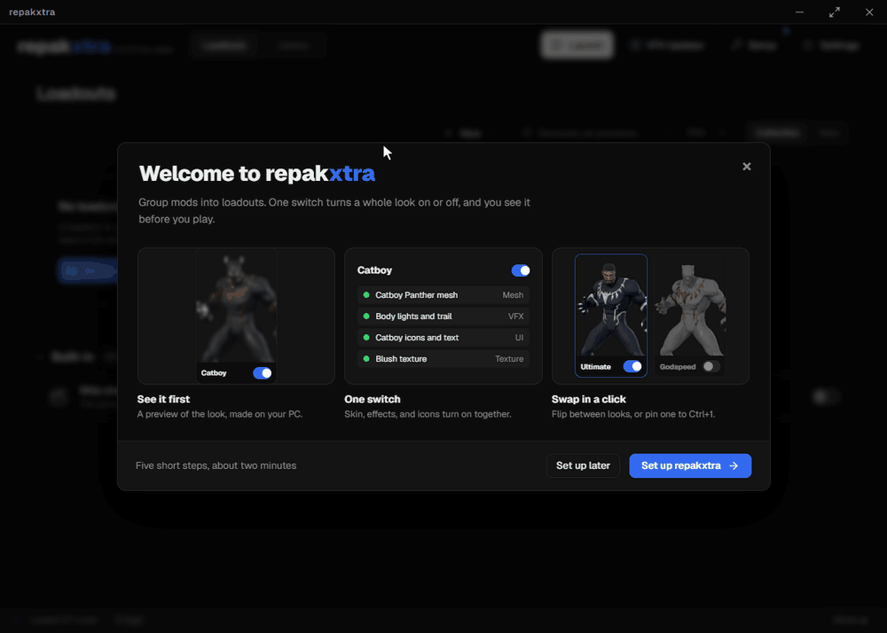

Smart loadouts is always a click away: **Loadouts > New > Smart loadouts** sorts the mods you added since. With mods
and no loadouts yet, the Loadouts screen offers **Group my mods into loadouts** right away.

## How to create your first loadout

A loadout is a group of mods with one switch, like one look for a hero. It gets a picture of what the mods look like
in the game.

1. **Set up previews (only once).** Skip this if you did it in **Make it yours**. Otherwise click **Setup** at the
   top and, under **Mod previews**, click **Set up previews**. It downloads the free preview kit (about 110 MB) and
   installs Blender, the free program that draws the pictures. If Windows asks whether to allow changes, click **Yes**.
   When it says **Ready**, close Setup.
2. **Install a mod** as in the steps above: drag the file onto the window and drop it on **Install Mods** (or click
   **Install** in the Library and pick it). To make the loadout yourself, click **Install without a loadout**.
   (**Install and save loadout** does steps 3 to 6 for you.)
3. **Make a loadout.** Click **Loadouts** at the top, then **New** and **New loadout**.
4. **Name it.** Type a name, like `Ultimate`, and press **Enter**.
5. **Add your mod.** Under **Add mods**, type part of the mod's name in the search box, then click the **+** next to it.
   It moves up to **In this loadout**.
6. **Make its picture.** Click **Generate previews** on the card at the left. The picture shows up there when it is
   ready; this can take a minute or two, and you can keep using the app while it works.
7. **Turn it on.** Click **Loadouts** at the top left of the page to go back. Click the switch on your loadout's card:
   blue turns all its mods on, grey turns them off. Mods that are not in the loadout stay as they are.

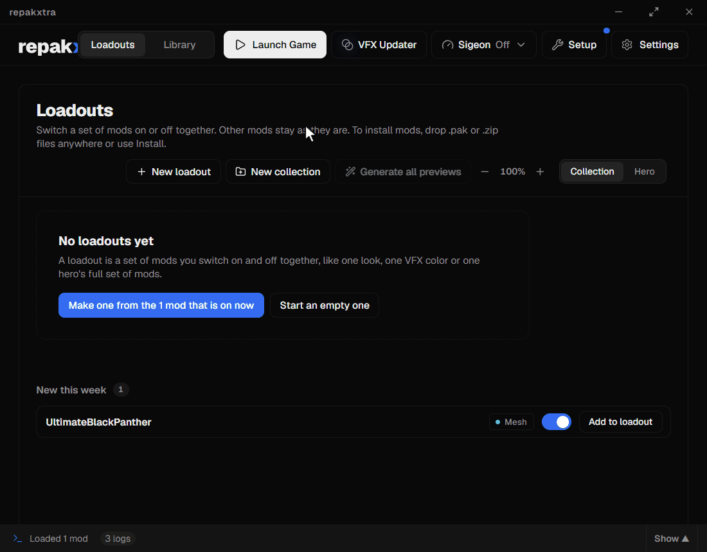

## How to batch update VFX mods

A game update can break VFX mods and mods that change materials, like a skin's glow or shine: colors go wrong or the
game crashes. The VFX Updater rebuilds them on the new game files, many at once.

1. **Close Marvel Rivals.**
2. **Open the VFX Updater.** Click **VFX Updater** at the top. A yellow dot on it means some of your mods need an update.
3. **Check what is ticked.** Mods that need an update are ticked already, under **Needs an update**. To add others,
   tick them under **Other VFX mods** or **Material mods**, or click **Select all** on a group. Not sure about a mod?
   Tick it and click **Scan**: it checks whether its materials were made for this game version, whatever its date says.
4. **Missing a mod?** Click **Add .utoc** and pick its `.utoc` file, or right-click it in the Library and click
   **For modders > Send to VFX Updater**.
5. **Click Update** (or press `Ctrl+Enter`). The line at the bottom says about how long it will take, and each mod
   shows its progress as it goes. **Cancel** (or `Esc`) stops the run.
6. **Check the result.** Finished mods move down to **Updated**. The updated copy keeps the mod's name, loadouts and
   tags. The original is turned off and renamed to end in `_BROKEN`. Click **Change** at the bottom to pick another
   way: move originals to **Recently deleted**, or leave them as they are. **Copy report** copies what each update did.
7. **Launch the game** and check your mods.

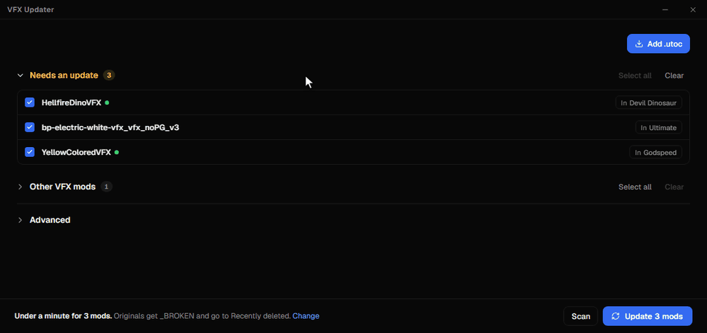

> [!NOTE]
> The VFX Updater needs a USMAP that matches the game, and it fetches the newest one by itself. Right after a game
> update one may not be out yet: mods with Niagara effects then update partly, and their original stays, off, so you
> can update them fully later. **Check for updates** in the VFX Updater looks for a newer USMAP.

## Features

**Loadouts**
- One click turns a set of mods on or off. Loadouts are independent, and you are warned when two that are on change the same hero.
- **Smart loadouts** (**New > Smart loadouts**) makes loadouts from the mods that are in none: mods that share a look
  become one loadout, and a lone mod gets its own. Simple is a ticked list. Advanced moves mods, merges loadouts and
  keeps word rules for next time.
- Collections or a view by hero. Drag a card to reorder it or move it to another collection; the pencils rename
  loadouts and collections. **−** and **+** in the header (or `Ctrl` + scroll) change the card size, and **Search
  loadouts...** finds one by name or collection.
- Make one from the Library selection, the right-click menu or while installing. Undo for every removal, and a deleted
  loadout waits 7 days in **Settings > Recently deleted** with its cover.
- A loadout remembers each mod by its folder and name, so changing a mod's priority keeps it in the loadout, and two
  mods with the same name in different folders stay apart.
- On a loadout's page: add and remove mods, rename a mod, turn single mods on or off, and **More > Export as zip** (every
  mod's files in one zip, named after the loadout). Mods installed from the page join the loadout, and mods deleted
  from the Library show a red **Deleted** tag. Changes save as you make them.
- Pick what the card shows under it on the loadout's page: the rendered **Preview**, a **Capture** from the game, your
  own **Image** (or GIF or video), or **Text**, a title with an icon and a color. Each one is kept, so you can switch
  back any time.
- Pin a loadout to `Ctrl+1` to `Ctrl+9` (More > Hotkey on its page) to switch it from anywhere.

**Previews**
- Character mods render on the hero in the lobby pose, using the mods' real materials. A loadout's mods render together.
- Heroes with forms get one picture per form the mod changes (Magik and Darkchylde, Hulk's three). A card's pictures
  turn like a carousel with its arrows.
- Animations get a looping clip, VFX mods a palette of the colors they change, UI mods an icon sheet, sound mods a list.
  When a loadout has an emote's sound mod, hovering the emote's clip plays its sound (each card can mute it).
- Mods that put another skin on a hero's default through the skin table render as that skin.
- **Generate all previews** queues every loadout, and each card says what it is doing while it renders. Mods with
  nothing to show are marked "Nothing to render".
- **Capture in game:** with the game open, pick **Capture** under a loadout's card and click **Capture screenshot**,
  switch to the hero's Overview or Cosmetics screen in the game, then press `Ctrl+Shift+X`.

> [!NOTE]
> Rendered previews need the preview kit and [Blender](https://www.blender.org/download/) (free). **Setup > Mod previews** installs both.

**Built-in mods:** **Skip startup logos** (the game opens without the Marvel, NetEase and Unreal Engine logo videos).
It starts off. repakxtra makes it from your own game files when you turn it on, and rebuilds it
after every game update, so they never go stale. They sit at the bottom of the Loadouts screen and at the top of the
Library with a blue **Built-in** badge.

**Library:** hero and type filters (Nexus and Project Galacta mods too), double-click to rename, and the arrow keys
move through the list. Switching to Loadouts and back keeps your search, filters and checked mods; **Show all** clears
the filters. Libraries of thousands of mods stay quick. Deleted mods (and a mod's old version when it is updated, or a folder's mods when the folder is deleted) wait 7 days in **Settings > Recently deleted**
(Undo right after a delete, Restore any time before). Mods that are on and clash with another mod that is on (a PAK and an IoStore mod
that replace the same asset count too) get a red **Conflict** badge, and **Check Conflicts** shows a red dot while any do; it groups the clashing mods and says what they
replace ("These 3 mods replace Black Panther's materials"); **Keep this one** on a mod turns the others in its group off,
with Undo. Mods installed from a Nexus Mods download get an orange **Nexus** tag that opens their page, and their source
in mod details ("Nexus 12890, uploaded Sep 13, 2026" with **Open page**), read from the download's file name. On its
first launch repakxtra finds the source of mods you installed earlier from the Nexus downloads still in your Downloads
folder. Project Galacta mods get a magenta tag. File sizes are a setting (**Settings > Interface > On each mod**), and
**Settings > Interface > On each mod** hides the Nexus tag and the Broken and Conflict warnings.

**Installing:** drop zips, rars and 7zs as they are, no need to extract. Reinstalling or updating a mod builds the
new version first and keeps the old one in **Recently deleted**, so a failed install leaves your mod as it was. `.pak.off`, `.utoc.off` and `.ucas.off` files
(how RivalsFPS turns mods off, and how they often get shared) install like any other mod, each set as one mod, on.

**When something breaks:** a crash alert's **See suspects** lists the mods that were on, ranked by how closely they
match the crash (the asset that crashed, then the skin, then the hero it names), checked, to turn off together with Undo. **Copy setup report** (in **Setup** and
**Settings > Help & Community**) copies your setup, conflicts, newest crash and the mods that are on as text for a help
channel, with no folder paths or user name. Audio and UI mods say in their details when they only look broken
(cooldown sounds in the practice range).

**Setup:** the signature bypass ships inside the app (with an "Is it safe?" report), Project Galacta installs and updates in one click, and the preview kit and Blender install from here. Every install shows its steps as it goes. **Guided setup** opens the first-launch setup again.

**Encrypt:** right-click mods in the Library and click **Encrypt** to keep them from being extracted in FModel. The
originals are kept as backups, and each mod stays on or off as it was.

**Make it yours:** a sound pack (Bell, Mech, Bubble or Press, or none) in **Settings > Interface**, next to UI scale,
animations and lighter graphics for slower PCs. `F3` shows a frame rate counter.


## See it in action

**Turn a loadout on.** One switch per loadout; its mods switch together, and the dot says how many are on. A switch
half way across means only some of them are, and clicking it turns on the rest.

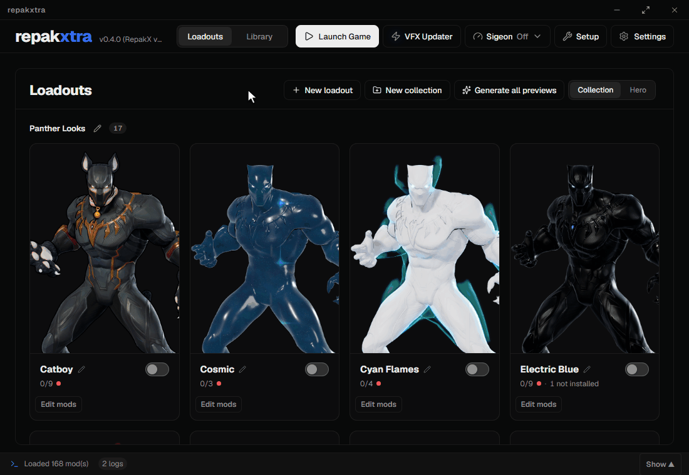

**Make a loadout.** Name it, search your mods, add them, turn it on. Every change saves as you make it.

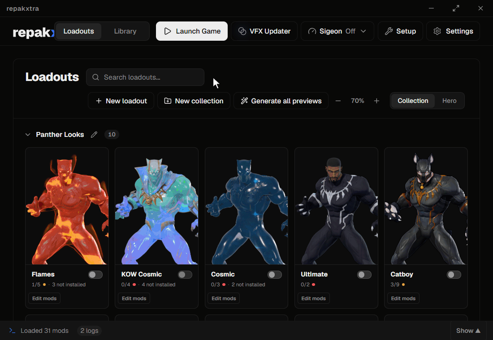

**Page through previews.** Hover a card for its renders, VFX colors and UI icons; a loadout's page shows them larger.

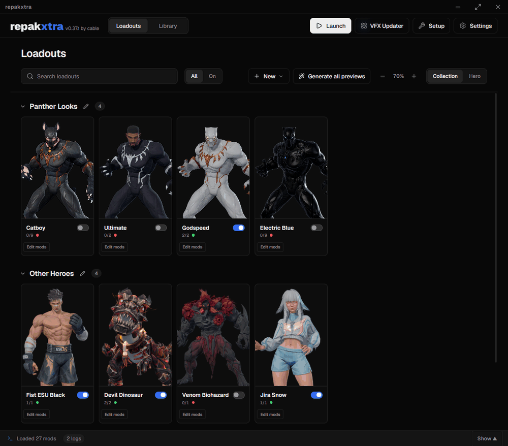

**Check Conflicts.** Mods that change the same files are grouped and described in words. Switch off the ones you don't
want until it says **All resolved**.

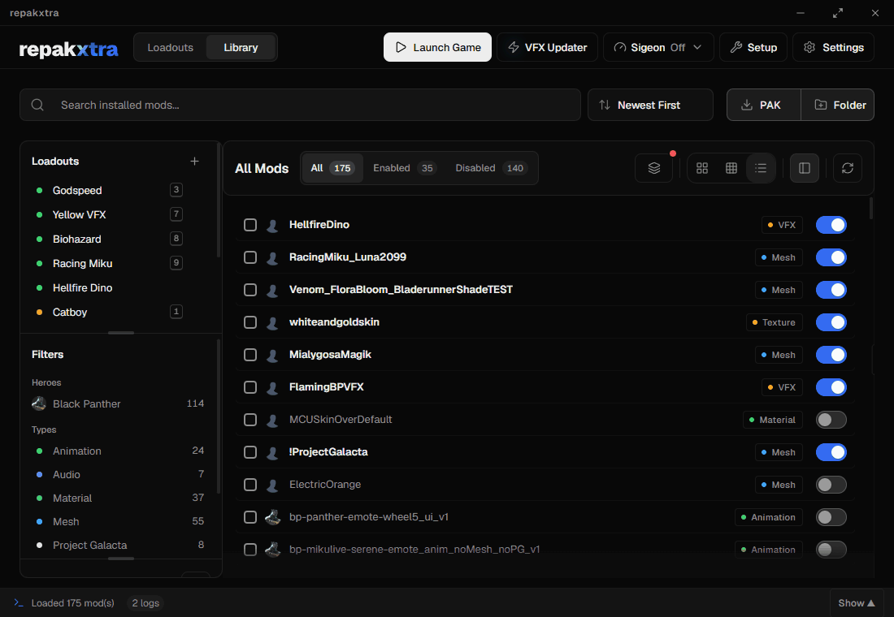

**Recently deleted.** A deleted mod waits 7 days in **Settings > Recently deleted**; **Restore** puts it back.

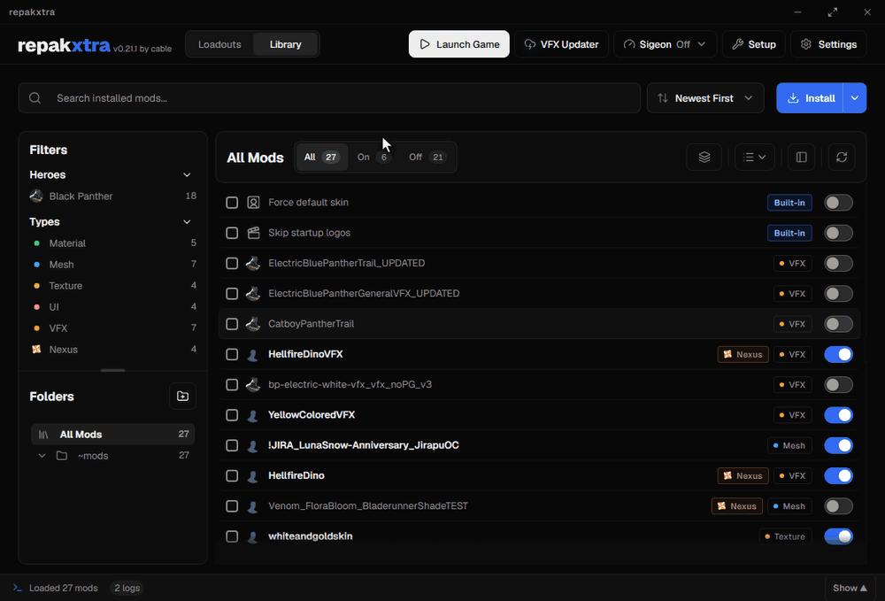

## Keyboard shortcuts

| Keys | Action |
| --- | --- |
| `F1` | Show every shortcut |
| `L` | Switch between Loadouts and the Library |
| `Ctrl+1` to `Ctrl+9` | Turn the loadout pinned to that number on or off (pick it in More > Hotkey on the loadout's page) |
| `Ctrl+G` | Launch the game |
| `F3` | Show or hide the frame rate counter |
| `Ctrl+O` | Install PAKs or archives |
| `Ctrl+Shift+X` (in game) | [Capture the loadout's picture](#features), once **Capture screenshot** is open |

## Screenshots

<table>
  <tr>
    <td width="50%"><br><sub>A loadout's page</sub></td>
    <td width="50%"><br><sub>Generating a loadout's previews</sub></td>
  </tr>
  <tr>
    <td width="50%"><br><sub>Library</sub></td>
    <td width="50%"><br><sub>Setup</sub></td>
  </tr>
  <tr>
    <td width="50%">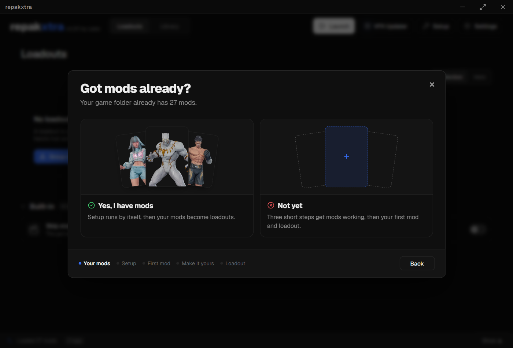<br><sub>The first-launch setup</sub></td>
    <td width="50%">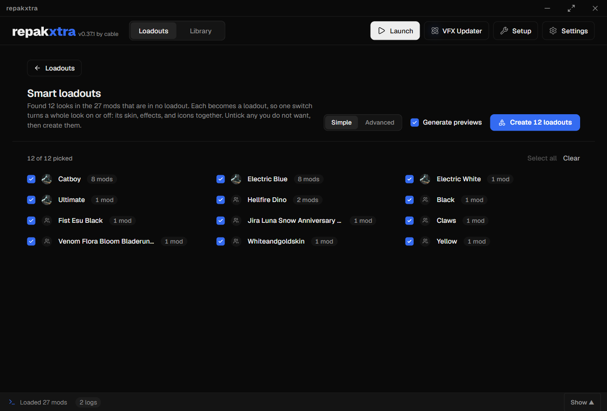<br><sub>Smart loadouts</sub></td>
  </tr>
  <tr>
    <td width="50%">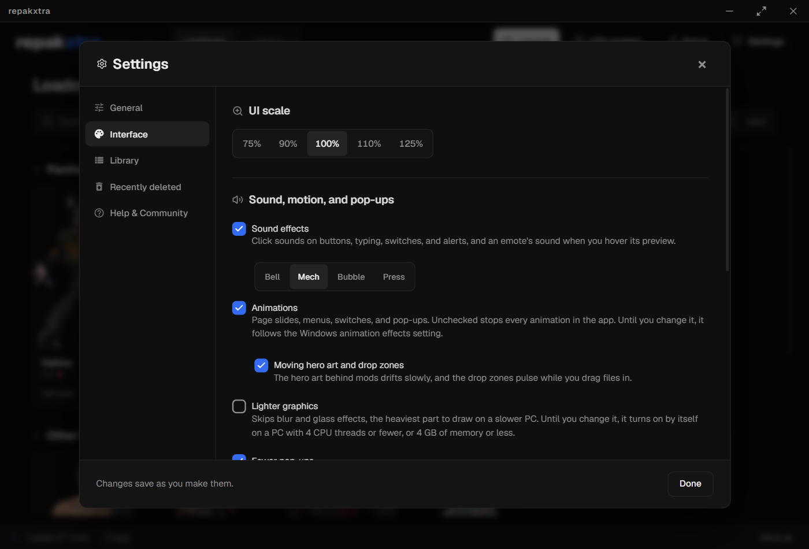<br><sub>Settings: UI scale, sound packs and motion</sub></td>
    <td width="50%"></td>
  </tr>
</table>

## FAQ

<details>
<summary><strong>Is repakxtra the official Repak X?</strong></summary>
<br>

No. repakxtra is an unofficial fork of [Repak X](https://github.com/X-zant/Repak-X). Installing, conflict checks,
the Asset Explorer and the VFX Updater are Repak X's work. repakxtra adds loadouts, Smart loadouts, previews and guided setup.
Bugs in repakxtra belong here, not with the Repak X team.

</details>

<details>
<summary><strong>Why does every mod need the signature bypass?</strong></summary>
<br>

Marvel Rivals only loads files it has signed, so a mod that replaces game files is ignored without the bypass.
repakxtra ships the bypass inside the app: **Setup** installs, repairs or turns it off, and its
**Is it safe?** report shows what gets installed. Close the game before changing anything in Setup.

</details>

<details>
<summary><strong>What is Project Galacta, and do I need it?</strong></summary>
<br>

Most skin mods need it. It loads more types of mods and lets you toggle mods in game. **Setup** installs the newest
[Project Galacta](https://github.com/0xSaturno/ProjectGalacta) release in one click and tells you when an update is out.

</details>

<details>
<summary><strong>Can I keep Repak X installed too?</strong></summary>
<br>

Yes, and both can be open at once: repakxtra has its own app identity and settings. Both apps change the game's
files, so close Repak X before switching, installing, renaming or deleting mods, or changing Setup, in repakxtra.
While Repak X is open, repakxtra refuses those changes and says why.

</details>

<details>
<summary><strong>Why can't I switch mods or loadouts right now?</strong></summary>
<br>

The game is running, or Repak X is open. Mods and loadouts only switch while Marvel Rivals is closed (close the game,
switch, then launch it again with `Ctrl+G`), and while Repak X is closed (both change the same files).

</details>

<details>
<summary><strong>How do I get mod previews?</strong></summary>
<br>

Rendered previews need the preview kit and [Blender](https://www.blender.org/download/) (free).
**Setup > Mod previews** downloads the newest kit from GitHub and installs Blender if it's missing; a kit zip picked
with **Install from file…** or dropped on the window installs too. It shows where your kit came from and checks GitHub for
updates. Without either, the **Capture** cover on a loadout's page uses a screenshot of the hero instead.

</details>

<details>
<summary><strong>How do I update repakxtra?</strong></summary>
<br>

**Settings > Updates > Check Now.** When a newer release is out, **Download update** fetches it and
**Install and restart** replaces the app and opens the new version. Loadouts, settings and pictures carry over.

</details>

<details>
<summary><strong>The game crashed. Which mod was it?</strong></summary>
<br>

The crash alert has **See suspects**: the mods that were on and hold the asset that crashed, or else the ones that
change the hero the crash names. They come checked; **Turn off selected** switches them off, with Undo. For a crash
from before repakxtra started, the crash report does not say which mods were on, so the list uses the mods on now. With
no match, turn mods off a few at a time to find it.

</details>

<details>
<summary><strong>Two mods change the same thing. How do I pick one?</strong></summary>
<br>

**Check Conflicts** groups them. **Keep this one** on the mod you want turns the others in its group off, with Undo;
or raise its priority so it wins instead.

</details>

<details>
<summary><strong>Someone sent me .pak.off files. Do I rename them?</strong></summary>
<br>

No. Drop them as they are (a zip of them too): repakxtra drops the ".off", keeps each pak, utoc and ucas together as
one mod and installs it on. Your original files stay as they were.

</details>

<details>
<summary><strong>Where did this mod come from?</strong></summary>
<br>

Mods installed from a Nexus Mods download keep its mod id and upload date, read from the download's file name: mod
details shows "Nexus 12890, uploaded Sep 13, 2026" and **Open page**, and the Library shows a **Nexus** tag on the mod
(**Settings > Interface > On each mod** hides it and its filter). On its first launch repakxtra also checks the
Nexus downloads in your Downloads folder, so mods installed before keep their source. Mods from anywhere else show
nothing there.

</details>

<details>
<summary><strong>What should I do if I hit a bug?</strong></summary>
<br>

Update first (**Settings > Updates > Check Now**); a newer release may already fix it. If it persists, press **Copy
setup report** (in **Setup** or **Settings > Help & Community**) and paste it on [Discord](https://discord.gg/C7geHdWBP5)
with what you did and what happened. The report has your repakxtra version, Setup state, conflicts, newest crash and the
mods that are on, without folder paths or your user name.

</details>

## Building from source

**Requirements (Windows):** Git with [Git LFS](https://git-lfs.com/), [rustup](https://rustup.rs/) (`rust-toolchain.toml` picks the toolchain and the MSVC target), [Node.js](https://nodejs.org/) 22, the [.NET 8 SDK](https://dotnet.microsoft.com/download/dotnet/8.0), and Visual Studio Build Tools with the C++ workload (the MSVC linker).

Clone with submodules (the asset tool lives in `UAssetToolRivals`):

```powershell
git lfs install
git clone --recurse-submodules https://github.com/cablemp5/repak-xtra.git
cd repak-xtra
```

Build:

```powershell
# Live dev copy: the real app from the folder as it is, interface edits reloading on save (the first start compiles a debug build)
.\dev.ps1

# Builds the folder as it is, uncommitted edits included, into dist\Repak-X-Test\repakxtra.exe
.\build.ps1 -Test

# The stable build: only from a clean main. Open it as dist\repakxtra\repakxtra.exe (always the newest stable build)
.\build.ps1

# A release: builds main into dist\repak-xtra-v<version>-windows.zip and copies the gh command that publishes it
.\build.ps1 -Release
```

> [!NOTE]
> The app runs one copy at a time and both builds share `%APPDATA%\Repak-X`: close the stable repakxtra before opening the test one.

<details>
<summary>What <code>build.ps1</code> runs (the same steps as the release workflow)</summary>

```powershell
dotnet publish UAssetToolRivals/src/UAssetTool/UAssetToolNative.csproj -c Release -r win-x64 -p:DebugType=none -p:DebugSymbols=false -o target/uassettool
cd repak-x
npm install
npm run build
cd ..
$env:SKIP_UASSET_TOOL_BUILD = '1'
cargo build --release --target x86_64-pc-windows-msvc --features custom-protocol
```

It then copies `REPAK-X.exe` as `repakxtra.exe`, with the asset tool and `data\character_data.json`, into the output folder.
</details>

### Checks

Pull requests into `main` must pass **Typecheck, build and test** (`.github/workflows/checks.yml`). Run the same locally:

```powershell
cd repak-x
npm ci
npx tsc --noEmit -p .
npm run test:unit   # the interface's self-checks
npm run build
cd ..
$env:SKIP_UASSET_TOOL_BUILD = '1'
cargo test --locked -p repak-x --bin REPAK-X
cargo test --locked -p uasset_app --lib
```

### Browser preview

```powershell
cd repak-x
npm run dev
```

This serves the interface in a normal browser with a mock backend (`src/dev/mockBackend.ts`) instead of the Rust one, so what it shows is fake data.

## Credits

- **[Repak X](https://github.com/X-zant/Repak-X)** by Xzant and Saturn, and everyone credited in its Credits panel.
- **Ultimate ASI Loader** by [ThirteenAG](https://github.com/ThirteenAG/Ultimate-ASI-Loader) (MIT), and the **Marvel Rivals UTOC Signature Bypass** from [Nexus Mods](https://www.nexusmods.com/marvelrivals/mods/2940).
- **[Project Galacta](https://github.com/0xSaturno/ProjectGalacta)** by 0xSaturno.
- [cuelume](https://cuelume-site.pages.dev/) sounds, [transitions.dev](https://transitions.dev/) motion recipes, [Geist](https://vercel.com/font) and [Lucide](https://lucide.dev/) icons.

## License

GPL-3.0, the same as Repak X. See [LICENSE](LICENSE).

