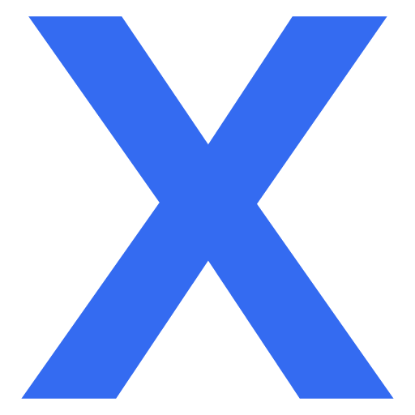
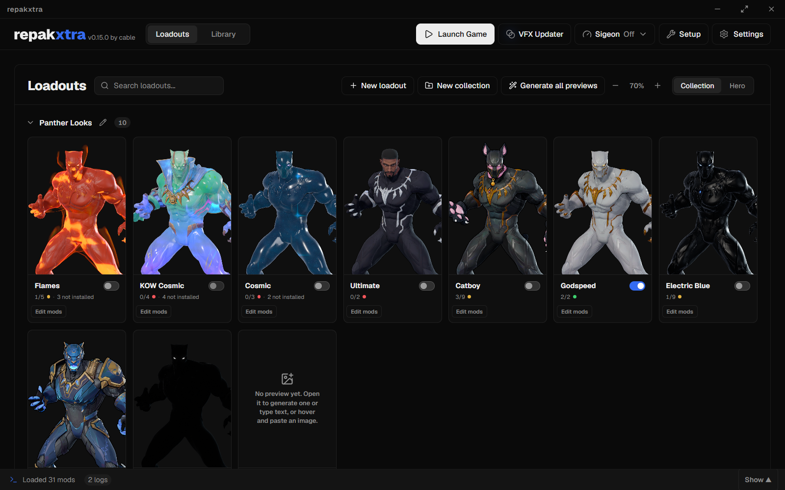
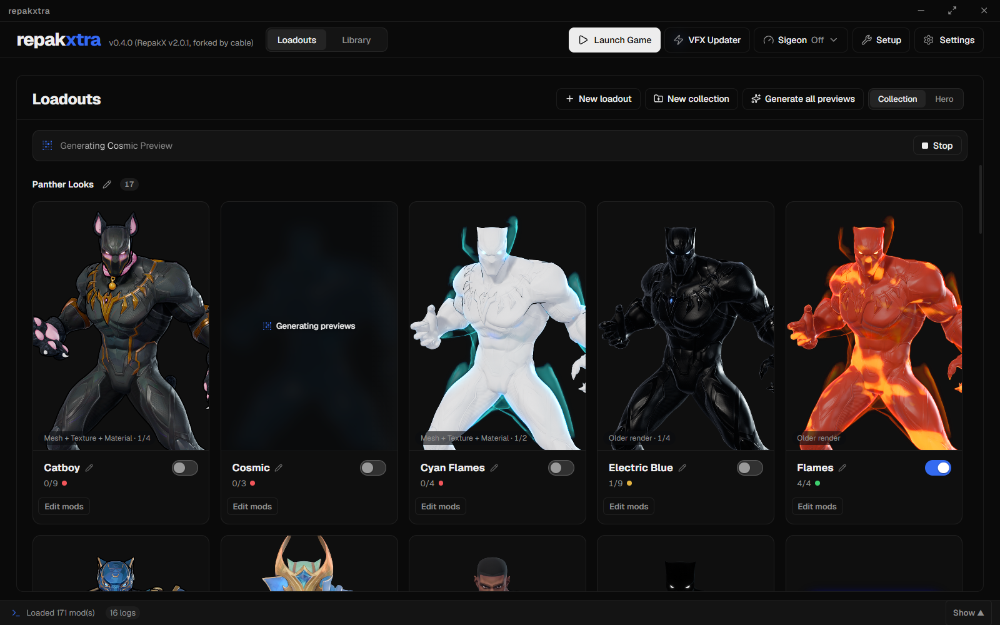
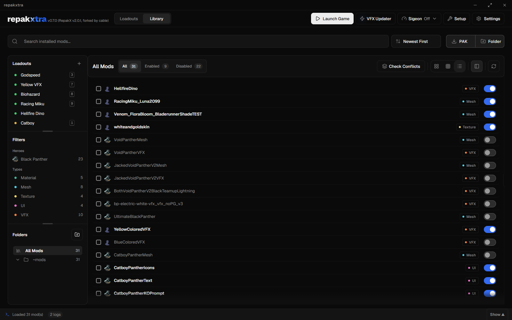
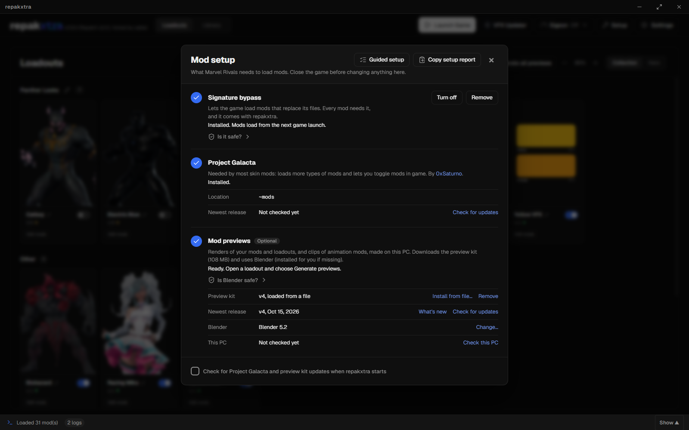
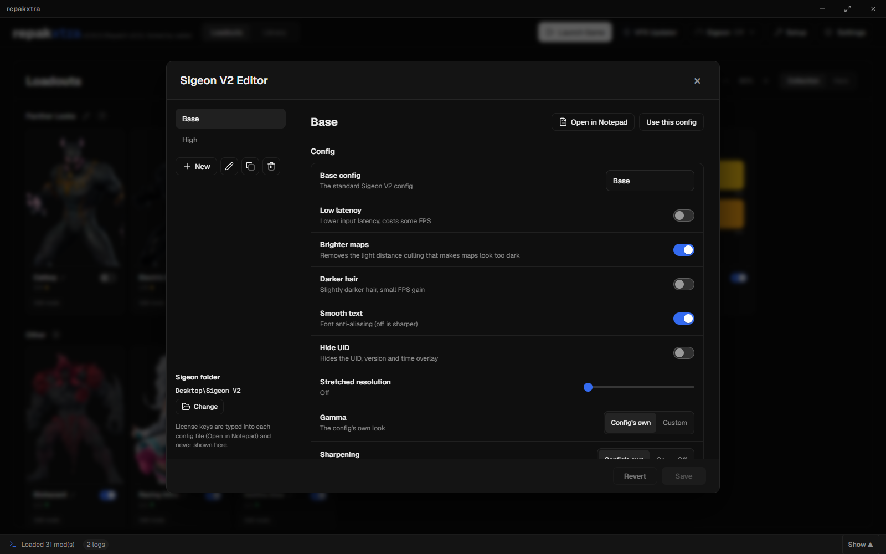
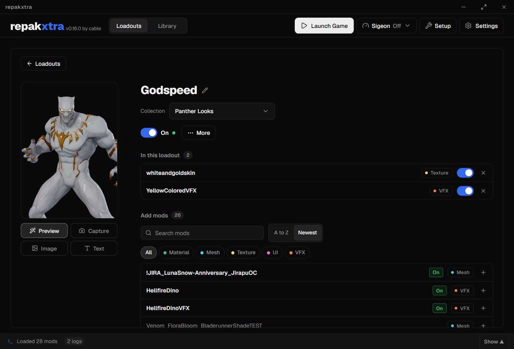

# repakxtra

**A Marvel Rivals mod manager built on [Repak X](https://github.com/X-zant/Repak-X), with loadouts, generated previews and one-click setup.**

repakxtra is cable's fork of Repak X. Everything Repak X does is still here; this fork adds a home screen of loadouts, rendered previews of your mods, a Sigeon V2 config editor and a setup panel for the tools mods need.

---

## Built on Repak X

repakxtra would not exist without **[Repak X](https://github.com/X-zant/Repak-X)** by **Xzant** (backend, project founder) and **Saturn** (frontend), with thanks to the people they credit: **Trumank** (the original repak and retoc libraries), **Krisan Thyme** (the first Rivals skeletal mesh patcher), **Natimerry** (Repak Rivals GUI, which inspired Repak X), **amMatt** and the **Marvel Rivals Modding Server**. Installing, organizing, conflict checks, the Asset Explorer, the VFX Updater and the rest of the core all come from Repak X. Please support the original project.

This fork is personal and unofficial: it is not made by the Repak X team, and neither project is affiliated with NetEase or Marvel.

## What repakxtra adds

### Loadouts
- **Loadouts screen**: a grid of cards, one per loadout, that opens with the app. Each card has a picture, an on and off switch and a count like `3/7 on`.
- **Turn a whole look on or off** with one switch. Loadouts are independent: switching one never touches mods outside it. A warning appears when two loadouts that are on change the same hero.
- **Groups**: sort loadouts into named groups (create, rename, reorder, delete with Undo, drag cards between them), or view them by hero.
- **Loadout pages**: name, group, picture or video, every mod in the loadout with its own switch, and a searchable list to add more by type.
- **Make loadouts anywhere**: from the Library's selection, the right-click menu (`Add to loadout`), the sidebar's `+`, or while installing several mods at once.
- **Ctrl+1 to Ctrl+9** switch the first nine loadouts. **L** jumps between Loadouts and the Library.
- **Undo everywhere**: removing mods, replacing a loadout, deleting a group or a loadout.
- **New this week**: recently installed mods, with one click to add them to a loadout or swap in a newer version.

### Generated previews
- **Rendered pictures of your mods**: character mods are rendered on the hero in the lobby pose with the game's toon outline. Previews read the mods' real materials: inherited textures and colors, cosmic galaxies, glassy "jelly" skins, chrome and gold, Human Torch's burning body and flame shells, and Damisa-style eyes.
- **Combined loadout renders**: a loadout's mesh, textures and its VFX eye and body-light colors render together on one character.
- **Cards for every kind of mod**: VFX mods get a palette of the colors they actually change, UI mods a sheet of their icons (a whole emote wheel), and sound mods a list of the sounds they replace.
- **A carousel on each card** pages through the loadout's pictures in a fixed order: mesh, texture, material, animation, VFX, UI, text, audio.
- **Generate all previews** with a queue, a progress line, Stop, and the choice to redo only loadouts without a preview. Unchanged mods are not rendered again.
- **Preview kit**: previews need the generator, Python and tools that come as a separate download (Setup > Mod previews), plus [Blender](https://www.blender.org/download/), which is free.

### Library
- Loadout sidebar, hero and type filters, a filter title that stays readable, double-click to rename, and a right-click `Add to loadout` menu.
- A clear tags toggle (`Tags shown` or `Tags hidden`) with **Delete all tags** (with Undo).
- **Undo for deletes**: deleted mods go to a trash folder and come back exactly as they were.

### Setup
- **Signature bypass in one click**: the UTOC signature bypass ships with repakxtra. Install it, turn it off or on, or remove it. `Is it safe?` shows the VirusTotal result, that the loader is byte for byte ThirteenAG's Ultimate ASI Loader 7.7.0, what the bypass can and cannot do, and every file's SHA-256.
- **Project Galacta**: checks GitHub for the newest release, updates in one click into the folder you choose, and shows the release notes.
- **Mod previews**: installs and updates the preview kit, and finds Blender or lets you pick `blender.exe`.

### Sigeon V2 Editor
- Create, duplicate, rename and delete Sigeon V2 configs, pick the base config, flip its switches, set stretched resolution, gamma and sharpening, and add, edit or remove console overrides with search.
- Your notes in the files stay where they are. The license key is never shown or touched by the app; you type it into the config file yourself (`Open in Notepad`).
- Choose where your Sigeon folder lives. Switch configs from the header's Sigeon menu.
- No Sigeon yet? The header reads `Sigeon not configured` and opens a short setup: where to buy it ([oinkerhub.com/CABLE](https://oinkerhub.com/CABLE)), the signature bypass it loads through, and its folder.

### Look and feel
- A quiet dark interface with one blue accent, the Geist typeface, and a lowercase `x` logo.
- Optional sound effects ([cuelume](https://cuelume-site.pages.dev/), mechanical theme) and motion ([transitions.dev](https://transitions.dev/) recipes), each with an off switch in Settings.
- UI scale from 90% to 150%.

## Getting started

1. Download the newest release from [Releases](https://github.com/cablemp5/repak-xtra/releases) and unzip it anywhere.
2. Open `repakxtra.exe`. If Windows SmartScreen warns about an unknown publisher, choose More info, then Run anyway.
3. Set your game's `~mods` folder in Settings (Auto Detect finds a Steam install).
4. Open **Setup** to install the signature bypass, Project Galacta and, for previews, the preview kit and Blender.

### Building from source
Windows, with Rust, Node.js and the .NET SDK installed: run `build.ps1` in the repository root. It builds the app into `dist\` the same way the release workflow does.

## Credits

- **[Repak X](https://github.com/X-zant/Repak-X)** by Xzant and Saturn, and everyone credited in its Credits panel.
- **Ultimate ASI Loader** by [ThirteenAG](https://github.com/ThirteenAG/Ultimate-ASI-Loader) (MIT), and the **Marvel Rivals UTOC Signature Bypass** from [Nexus Mods](https://www.nexusmods.com/marvelrivals/mods/2940).
- **[Project Galacta](https://github.com/0xSaturno/ProjectGalacta)** by 0xSaturno.
- **Sigeon V2** by its authors ([Discord](https://discord.gg/oinkers)); repakxtra only edits your own configs.
- [cuelume](https://cuelume-site.pages.dev/) sounds, [transitions.dev](https://transitions.dev/) motion recipes, [Geist](https://vercel.com/font) and [Lucide](https://lucide.dev/) icons.

## License

GPL-3.0, the same as Repak X. See [LICENSE](LICENSE).
