<p align="center">
  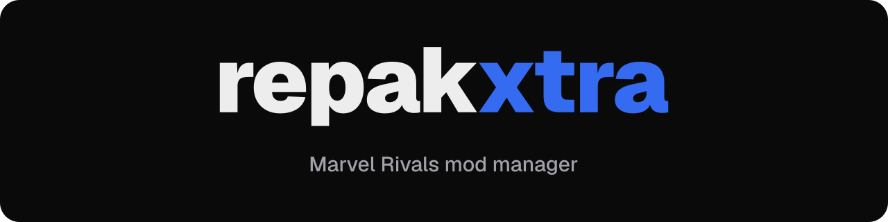
</p>

<p align="center">
  <a href="https://github.com/cablemp5/repak-xtra/releases"></a>
  <a href="https://github.com/cablemp5/repak-xtra/releases"></a>
  
  <a href="LICENSE"></a>
  <a href="https://github.com/X-zant/Repak-X"></a>
</p>

<p align="center">
  <b>A Marvel Rivals mod manager with loadouts, rendered previews, and a mod updater for game patches.</b><br>
  <a href="https://github.com/cablemp5/repak-xtra/releases/latest">Download</a> ·
  <a href="#get-started">Get started</a> ·
  <a href="#features">Features</a> ·
  <a href="#faq">FAQ</a> ·
  <a href="https://discord.gg/C7geHdWBP5">Discord</a>
</p>

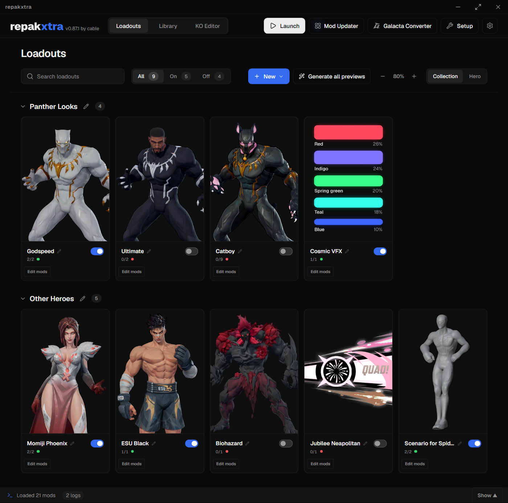

repakxtra is a fork of **[Repak X](https://github.com/X-zant/Repak-X)** by **Xzant** (backend, founder) and **Saturn**
(frontend), with thanks to **Trumank**, **Krisan Thyme**, **Natimerry**, **amMatt**, and the **Marvel Rivals Modding
Server**. Installing, conflict checks, the Asset Explorer, and the rest of the core are Repak X's work. Please support
the original project.

> [!NOTE]
> repakxtra is unofficial: not made by the Repak X team, and not affiliated with NetEase or Marvel.

## Get started

You need Windows, Marvel Rivals, and a mod (`.pak`, `.zip`, `.rar`, or `.7z`, no need to unzip it).

1. **Download** the file ending in `-windows.zip` from the [newest release](https://github.com/cablemp5/repak-xtra/releases/latest).
2. **Unzip it.** Right-click the zip, click **Extract All...**, then **Extract**.
3. **Close Marvel Rivals**, then double-click `repakxtra.exe`. If Windows says "Windows protected your PC", click
   **More info**, then **Run anyway**.
4. **Click Set up repakxtra.** Four short steps, about two minutes: it finds the game, installs the signature bypass and
   Project Galacta, and adds your first mod as a loadout.
5. **Click Launch.** Your mods load with the game.

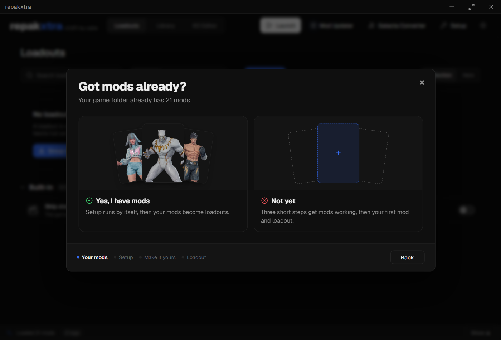

**Already have mods?** Click **Yes, I have mods** in the setup. It installs only what is missing, then
**Group my mods into loadouts** sorts every mod into a loadout per look.

> [!WARNING]
> Close the game before you install, switch, or delete mods, or change anything in **Setup**.

## Features

### Loadouts

A loadout is a group of mods behind one switch, like one look for a hero.

- Turn a whole look on or off with one click, or pin it to `Ctrl+1` to `Ctrl+9`.
- Sort loadouts into collections or view them by hero, and drag cards to reorder them.
- Pick what a card shows: the rendered preview, a capture from the game, your own image or video, or a text title.
- Export a loadout as one zip. Deleted loadouts wait 7 days in **Recently deleted**.

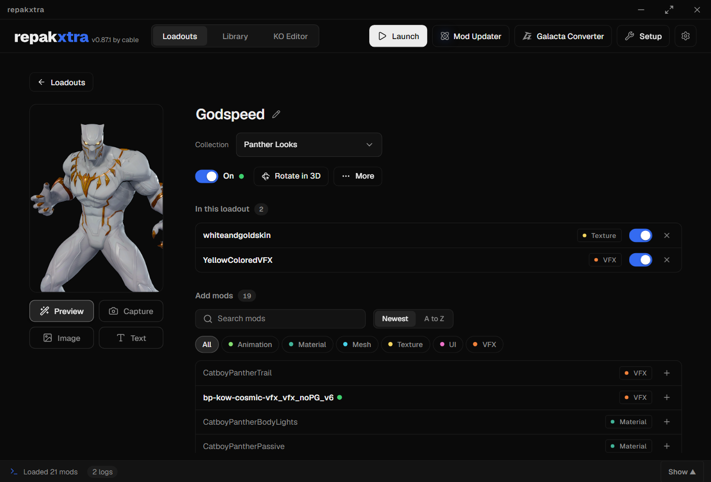

### Smart loadouts

**New > Smart loadouts** groups every mod that is in no loadout by look: a skin's mesh, effects, icons, and textures
become one loadout, in a collection named for its hero. Untick what you do not want, rename, and click **Create**.

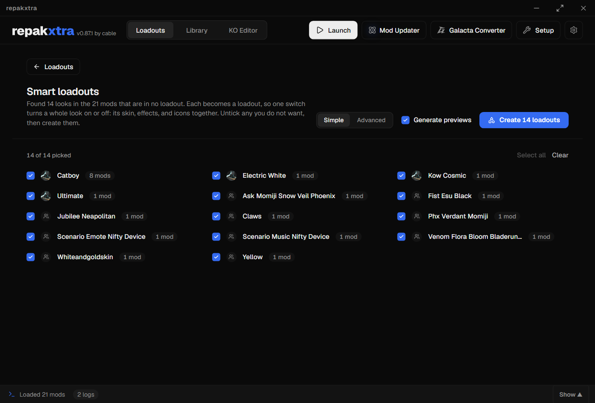

### Previews

- Skins render on their hero in the lobby pose, with the mods' own materials. Heroes with forms get a picture per form.
- **Rotate in 3D** shows the mod on its hero playing the lobby idle, with hair and cloth physics.
- Emotes and dances get a looping clip with their sound, VFX mods a palette of their colors, and UI mods an icon sheet.
- **Generate all previews** renders every loadout in the background and says how long is left.

Previews need the free preview kit and Blender. **Setup > Mod previews** installs both in one click.

### Mod Updater

A game update can break VFX, material, UI, emote, and KO prompt mods. The Mod Updater rebuilds them on the new game
files, many at once.

1. Click **Mod Updater** at the top. Mods that need an update are ticked already.
2. Click **Update**. The bottom line says how long it will take.
3. The updated copy keeps the mod's name, loadouts, and tags. A mod that cannot be updated moves to **Failed** and
   is turned off.

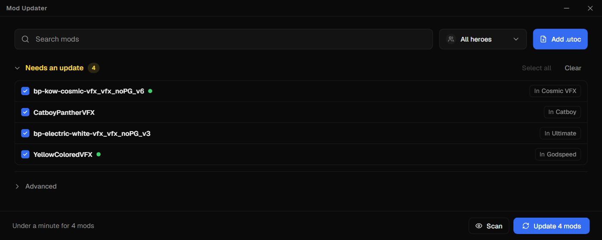

### Conflicts and crashes

- **Check Conflicts** groups mods that change the same files and says what they replace. **Keep this one** turns the
  others off.
- After a crash, **See suspects** lists the mods that hold what crashed. **Find the crashing mod** narrows it down to
  one mod in a few game launches.
- **Why isn't it working?** on a mod's right-click menu checks it and offers a fix where there is one.

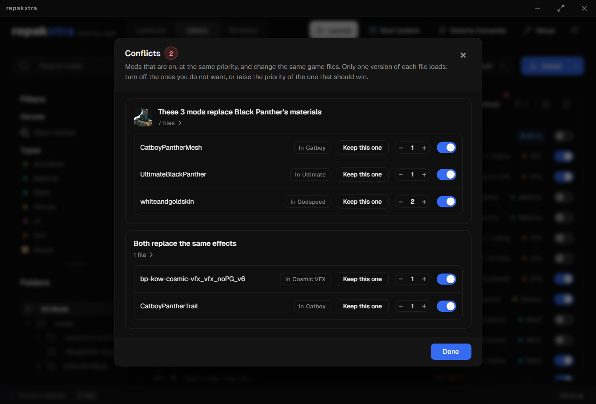

### Everything else

- **Library:** hero and type filters, Nexus tags that open a mod's page, and a 7-day **Recently deleted** for mods.
- **Setup:** the signature bypass (with an "Is it safe?" report), Project Galacta, the preview kit, **Backups** that
  restore missing mods after a Steam verify, and a **Ban risk** check.
- **More:** the KO Editor (recolor a hero's KO prompt and install it as a mod), the Galacta Converter, and Merge sounds
  for two sound mods that change the same sounds.
- **Make it yours:** sound packs, UI scale, lighter graphics for slower PCs, and Skip startup logos.

<table>
  <tr>
    <td width="50%">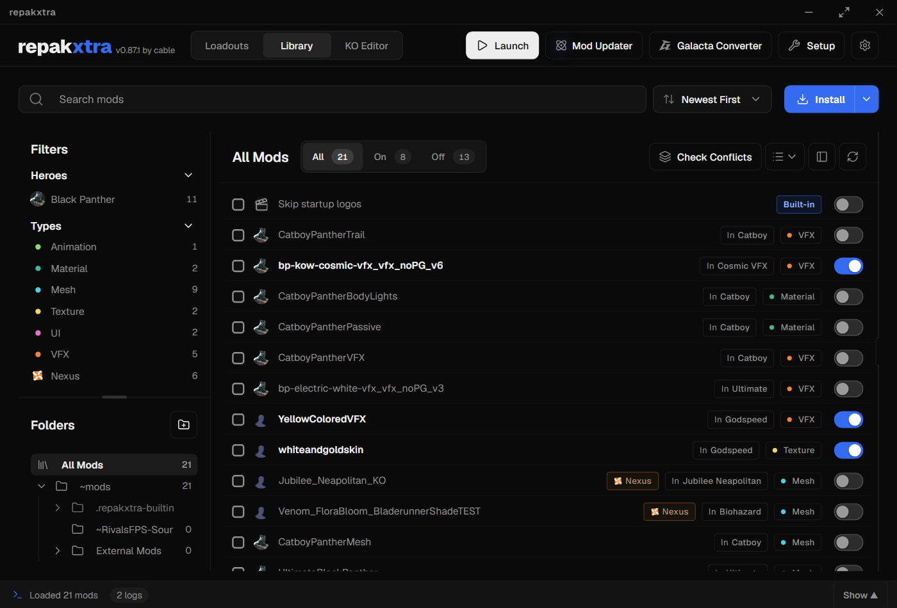<br><sub>Library</sub></td>
    <td width="50%">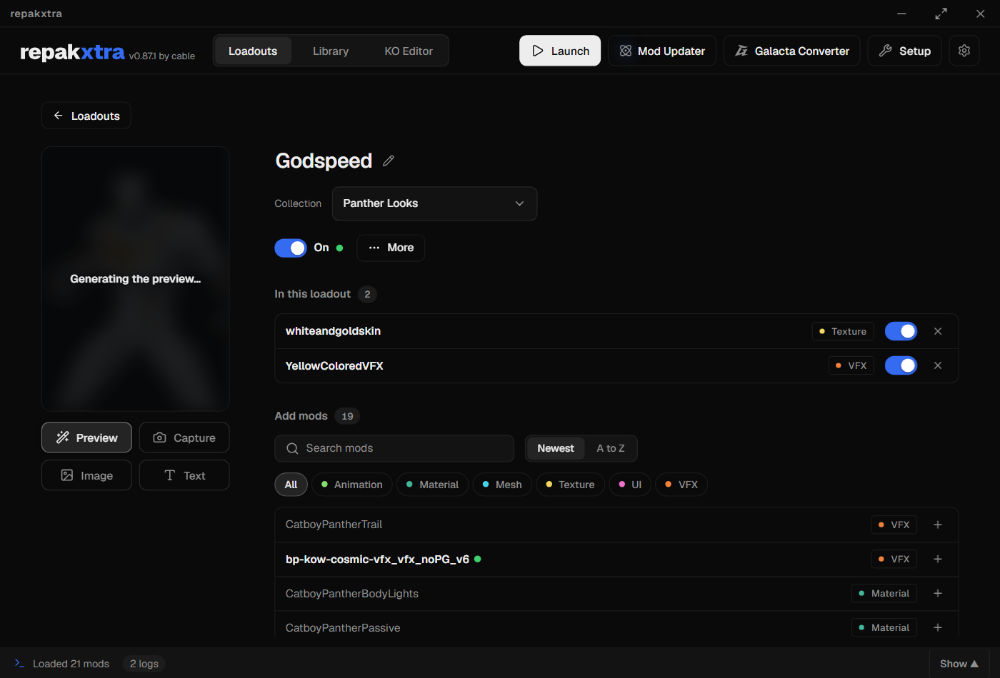<br><sub>A preview generating</sub></td>
  </tr>
  <tr>
    <td width="50%">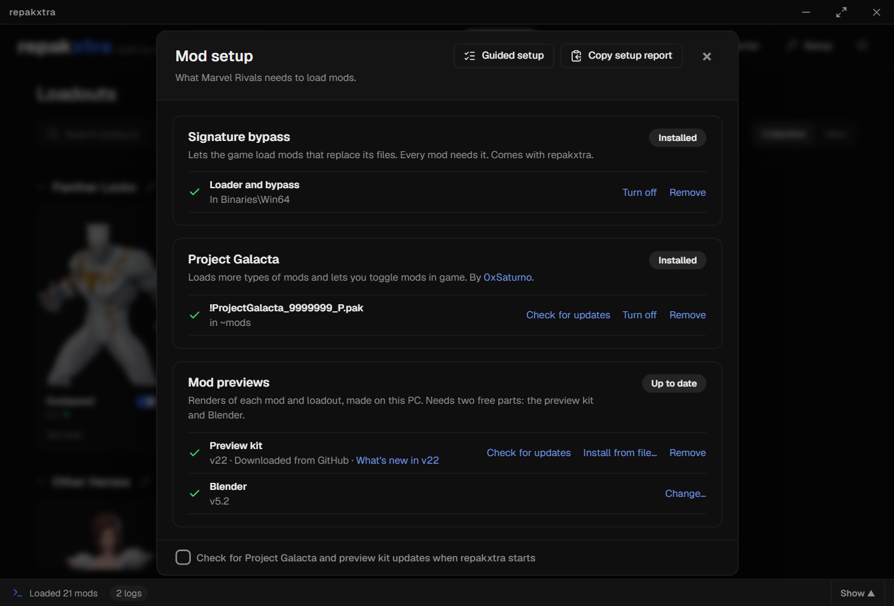<br><sub>Setup</sub></td>
    <td width="50%">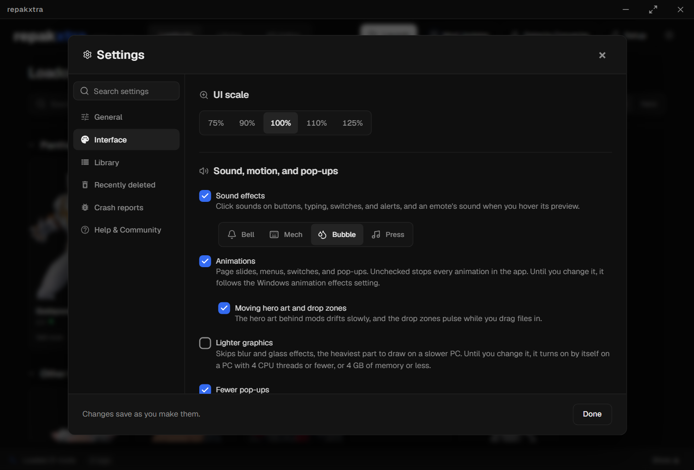<br><sub>Settings</sub></td>
  </tr>
</table>

## Keyboard shortcuts

Press `F1` in the app for the full list.

| Keys | Action |
| --- | --- |
| `L` | Switch between Loadouts and the Library |
| `Ctrl+1` to `Ctrl+9` | Turn the pinned loadout on or off (a loadout's page: **More > Hotkey**) |
| `Ctrl+G` | Launch the game |
| `Ctrl+O` | Install mods |
| `Ctrl+S` / `Ctrl+M` | Open Setup / the Mod Updater |
| `/` | Search the Library |

## FAQ

<details>
<summary><strong>Is repakxtra safe?</strong></summary>
<br>

repakxtra moves, renames, and switches mod files in the game's `~mods` folder, and **Setup** puts the signature bypass
(`dsound.dll` and one `.asi`) in `Binaries\Win64`. It does not touch the game's own files, run inside the game, or read
game memory. The source is public, and releases are built from it.

It only talks to GitHub (updates, Project Galacta, the preview kit, game mappings), Discord (the server widget), Nexus
Mods and imgur (mod images), and blender.org (only when installing Blender). The optional Discord role claim goes
through a small Cloudflare Worker that only grants the role. No account, ads, analytics, or telemetry.

The exe is not code-signed, so SmartScreen may warn the first time. Each release links its VirusTotal scan, and
**Settings > Help & Community > Is repakxtra safe?** checks the copy you are running. Mods break the game's terms, and
no mod is safe from a ban: mods that match the anti-cheat notice get a **Ban risk** badge.

</details>

<details>
<summary><strong>Why does every mod need the signature bypass?</strong></summary>
<br>

Marvel Rivals only loads files it has signed, so it ignores mods without the bypass. repakxtra ships it inside the app,
and **Setup** installs, repairs, or turns it off.

</details>

<details>
<summary><strong>What is Project Galacta, and do I need it?</strong></summary>
<br>

Most skin mods need it. It loads more kinds of mods and lets you toggle mods in game. **Setup** installs
[Project Galacta](https://github.com/0xSaturno/ProjectGalacta) in one click and tells you when an update is out.

</details>

<details>
<summary><strong>Can I keep Repak X installed too?</strong></summary>
<br>

Yes, both can be open at once with their own settings. Both change the same game files, so repakxtra refuses mod changes
while Repak X is open and says why.

</details>

<details>
<summary><strong>Why can't I switch mods right now?</strong></summary>
<br>

The game is running, or Repak X is open. Close the game and the change finishes by itself. Close Repak X and try again.

</details>

<details>
<summary><strong>The game crashed after an update. What now?</strong></summary>
<br>

Open the **Mod Updater** and update the mods it ticks. If it still crashes, use **See suspects** on the crash alert, or
**Find the crashing mod** in **Settings > Crash reports**.

</details>

<details>
<summary><strong>How do I update repakxtra?</strong></summary>
<br>

Updates download by themselves: click **Restart now** when it says one is ready. Or use **Settings > Updates >
Check now**. Loadouts, settings, and pictures carry over.

</details>

<details>
<summary><strong>I found a bug. Where do I report it?</strong></summary>
<br>

Update first, a newer release may already fix it. Then click **Copy setup report** (in **Setup** or **Settings > Help &
Community**) and paste it on [Discord](https://discord.gg/C7geHdWBP5) with what happened. The report has no folder
paths or user name.

</details>

## Building from source

**Requirements (Windows):** Git, [rustup](https://rustup.rs/) (`rust-toolchain.toml` picks the stable toolchain and the MSVC target), [Node.js](https://nodejs.org/) 22, the [.NET 8 SDK](https://dotnet.microsoft.com/download/dotnet/8.0), and Visual Studio Build Tools with the C++ workload (the MSVC linker). Git LFS is not needed: no file in the repo is stored with it.

Clone with submodules (the asset tool lives in `UAssetToolRivals`):

```powershell
git clone --recurse-submodules https://github.com/cablemp5/repak-xtra.git
cd repak-xtra
```

Build:

```powershell
# Live dev copy: the real app from the folder as it is, interface edits reloading on save (the first start compiles a debug build)
.\dev.ps1

# Builds the folder as it is, uncommitted edits included, into dist\Repak-X-Test\repakxtra.exe
.\build.ps1 -Test

# A release: only from a clean main whose check passed on GitHub. Builds the locked versions into
# dist\repak-xtra-standard-v<version>-windows.zip and copies the gh command that publishes it
.\build.ps1 -Release
```

There is no plain stable build: an installed copy updates itself from the releases (**Settings > Updates**).

> [!NOTE]
> The app runs one copy at a time and both builds share `%APPDATA%\Repak-X`: close the stable repakxtra before opening the test one.

<details>
<summary>What <code>build.ps1</code> runs</summary>

```powershell
dotnet publish UAssetToolRivals/src/UAssetTool/UAssetToolNative.csproj -c Release -r win-x64 -p:DebugType=none -p:DebugSymbols=false -o target/uassettool
cd repak-x
npm install
npm run build
cd ..
$env:SKIP_UASSET_TOOL_BUILD = '1'
cargo build --release --target x86_64-pc-windows-msvc --features custom-protocol
```

It then copies `REPAK-X.exe` as `repakxtra.exe`, with the asset tool and `data\character_data.json`, into the output folder.
`-Release` uses `npm ci` and `cargo build --locked` instead, so it builds exactly the versions CI tested.
</details>

### Checks

Pull requests into `main` must pass **Typecheck, build and test** (`.github/workflows/checks.yml`). Run the same locally:

```powershell
cd repak-x
npm ci
npx tsc --noEmit -p .
npm run test:unit   # the interface's self-checks
npm run build
cd ..
$env:SKIP_UASSET_TOOL_BUILD = '1'
cargo test --locked -p repak-x --bin REPAK-X
cargo test --locked -p uasset_app --lib
```

### Browser preview

```powershell
cd repak-x
npm run dev
```

This serves the interface in a normal browser with a mock backend (`src/dev/mockBackend.ts`) instead of the Rust one, so what it shows is fake data.

## Credits

- **[Repak X](https://github.com/X-zant/Repak-X)** by Xzant and Saturn, and everyone credited in its Credits panel.
- **Ultimate ASI Loader** by [ThirteenAG](https://github.com/ThirteenAG/Ultimate-ASI-Loader) (MIT), and the **Marvel Rivals UTOC Signature Bypass** from [Nexus Mods](https://www.nexusmods.com/marvelrivals/mods/2940).
- **[Project Galacta](https://github.com/0xSaturno/ProjectGalacta)** by 0xSaturno.
- [cuelume](https://cuelume-site.pages.dev/) sounds, [transitions.dev](https://transitions.dev/) motion recipes, [Geist](https://vercel.com/font) and [Lucide](https://lucide.dev/) icons.

## License

GPL-3.0, the same as Repak X. See [LICENSE](LICENSE).

